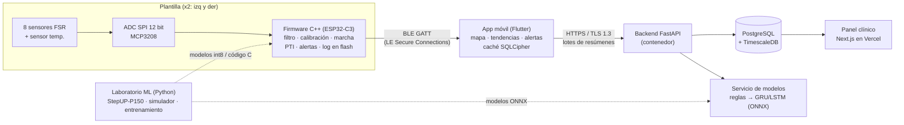

# Plantilla Baropodométrica Inteligente para Prevención de Úlceras de Pie Diabético
## Documento maestro de arquitectura, estructura de código y plan de trabajo

> **Versión:** 0.1 (borrador de trabajo) · **Fecha:** 13-oct-2026
> **Alcance:** dispositivo completo de monitoreo continuo (par de plantillas + app móvil + backend + modelos ML)
> **Hardware de adquisición:** ESP32-C3 SuperMini
> **Estado clínico:** prototipo de investigación. Ningún umbral de este documento está validado clínicamente.

---

## Tabla de contenido

1. [Resumen ejecutivo](#1-resumen-ejecutivo)
2. [Decisiones clave de arquitectura](#2-decisiones-clave-de-arquitectura)
3. [¿Dónde se procesa qué? Python vs C++](#3-dónde-se-procesa-qué-python-vs-c)
4. [Arquitectura del sistema](#4-arquitectura-del-sistema)
5. [Hardware](#5-hardware)
6. [Contratos de interfaz (datos y BLE)](#6-contratos-de-interfaz-datos-y-ble)
7. [Estructura del repositorio (archivo por archivo)](#7-estructura-del-repositorio)
8. [Capa ML (Python)](#8-capa-ml-python)
9. [Firmware (C++ / ESP32-C3)](#9-firmware-c--esp32-c3)
10. [Aplicación móvil](#10-aplicación-móvil)
11. [Backend y despliegue (Vercel y alternativas)](#11-backend-y-despliegue)
12. [Seguridad, privacidad y cumplimiento](#12-seguridad-privacidad-y-cumplimiento)
13. [Estrategia de pruebas y CI/CD](#13-estrategia-de-pruebas-y-cicd)
14. [Plan de trabajo](#14-plan-de-trabajo)
15. [Riesgos](#15-riesgos)
16. [Puntos técnicos a corregir o validar en el contexto original](#16-puntos-técnicos-a-corregir-o-validar)
17. [Decisiones abiertas](#17-decisiones-abiertas)
18. [Glosario](#18-glosario)

---

## 1. Resumen ejecutivo

### Problema
En México, el 18.3% de los adultos tiene diabetes (ENSANUT). Entre 15% y 25% desarrollará una úlcera de pie diabético (UPD), con recurrencia de hasta 65% a tres años. Las complicaciones del pie diabético consumen entre 20% y 30% del presupuesto de diabetes en el sector público, y la mortalidad a 5 años tras amputación mayor supera el 70%.

La baropodometría tradicional es estática, costosa, descalza y de pocos minutos. Una úlcera se forma por **carga repetida y sostenida durante semanas**, no por lo que ocurre en una consulta de 5 minutos.

### Solución
Un **par de plantillas instrumentadas** que se usan dentro del calzado habitual y miden la presión plantar en 8 zonas anatómicas de forma continua. Sustituyen la "fotografía estática" por una "película dinámica":

- **Plantilla** (ESP32-C3 + 8 sensores FSR): adquiere, filtra, calibra, detecta marcha, acumula la integral presión-tiempo (PTI) y dispara alertas de forma autónoma.
- **App móvil**: muestra mapa de presión en vivo, tendencias y asimetrías, y notifica al paciente.
- **Backend**: almacena el historial longitudinal, ejecuta análisis y modelos de riesgo, y alimenta un panel clínico.
- **ML en Python**: entrena y valida los modelos que luego se despliegan en el borde (cuantizados) o en el backend.

### Principio rector de diseño
> **Todo lo que debe funcionar sin teléfono, en tiempo real o con el menor consumo posible va en C++ en la plantilla. Todo lo que requiere historia larga, comparación entre pacientes o reentrenamiento va en Python en el backend. La app es interfaz, caché y puente.**

### Hallazgos importantes que afectan el diseño
1. El ESP32-C3 SuperMini **no tiene suficientes canales ADC utilizables** para 8 FSR (ADC1 expone 5 canales). Se requiere un ADC externo o multiplexor (sección 5).
2. El dataset UNB StepUP-P150 es de **sujetos sanos, descalzos, sin etiquetas clínicas**. Sirve para marcha y simulación de sensor, **no** para entrenar un modelo de riesgo de úlcera (sección 8).
3. El umbral "32 kPa sostenidos" parece confundir unidades. La referencia clásica de oclusión capilar es **32 mmHg ≈ 4.3 kPa** (sección 16).
4. Un FSR típico de bajo costo se **satura** muy por debajo de 320 kPa. Hay que elegir sensores acordes al rango real (sección 5.3).
5. **Vercel no es viable para la app móvil con BLE** (Web Bluetooth no funciona en iOS). Sí sirve para el panel web clínico (sección 11).

---

## 2. Decisiones clave de arquitectura

Registro tipo ADR (Architecture Decision Record). Cada una se documentará en `/docs/adr/`.

| # | Decisión | Elección | Alternativa descartada | Motivo |
|---|----------|----------|------------------------|--------|
| ADR-001 | Lugar del procesamiento en tiempo real | **C++ en el ESP32-C3** | Streaming crudo al teléfono y procesar en Python | Autonomía sin teléfono, menor consumo BLE, latencia baja, privacidad |
| ADR-002 | Entrenamiento y análisis longitudinal | **Python** | C++ | Ecosistema ML (PyTorch, scikit-learn), iteración rápida |
| ADR-003 | Adquisición analógica | **ADC externo SPI de 8 canales (MCP3208)** | ADC interno del C3 | Solo 5 canales ADC1, ruido y no linealidad del ADC interno |
| ADR-004 | Framework de firmware | **ESP-IDF + NimBLE + FreeRTOS** (PlatformIO opcional) | Arduino | Control de energía, OTA, secure boot, particiones, DMA |
| ADR-005 | App móvil | **Flutter** (alternativa: React Native) | PWA en Vercel | BLE en segundo plano en iOS/Android, una sola base de código |
| ADR-006 | Modelo en el borde | **Reglas + árbol/Random Forest convertido a C (emlearn) o MLP int8** | LSTM en el ESP32 | El C3 no tiene FPU y tiene 400 KB de SRAM |
| ADR-007 | Modelo de riesgo (fase 1) | **Reglas determinísticas (PTI, tiempo sobre umbral, asimetría térmica)** | LSTM entrenada con StepUP | No existen etiquetas clínicas; las reglas son auditables para regulación |
| ADR-008 | Backend | **FastAPI + PostgreSQL/TimescaleDB** en contenedor | Funciones serverless en Vercel | Inferencia ML, conexiones largas, residencia de datos |
| ADR-009 | Panel clínico web | **Next.js en Vercel** | Panel dentro de la app | Despliegue rápido, médicos usan escritorio |
| ADR-010 | Núcleo algorítmico | **Biblioteca C++ portable (sin dependencias de ESP-IDF)** | Reimplementar en Python y C++ por separado | Una sola fuente de verdad, se prueba en PC contra referencia Python |

---

## 3. ¿Dónde se procesa qué? Python vs C++

Esta es la pregunta central para un dispositivo de **monitoreo continuo**. La respuesta es un esquema de **tres niveles**, no una u otra.

### 3.1 Por qué no procesar todo en el teléfono con Python

- La plantilla debe alertar aunque el teléfono esté apagado, lejos o sin batería.
- Transmitir 8 canales a 100 Hz de forma permanente es el mayor consumidor de energía del sistema (radio BLE).
- Python no corre de forma nativa y eficiente en móvil; tendría que ir al backend, con latencia y dependencia de conexión.

### 3.2 Reparto recomendado

| Nivel | Lenguaje | Dónde corre | Tareas |
|-------|----------|-------------|--------|
| **Borde (plantilla)** | C++ | ESP32-C3 | Muestreo, filtrado, calibración por nodo, re-cero de deriva en fase de vuelo, detección de pasos y fases de marcha, picos y PTI por nodo y por paso, contadores de exposición, **alertas críticas por umbral**, registro en flash, empaquetado BLE |
| **Móvil** | Dart/Kotlin/Swift (Flutter) | Teléfono | Conexión a ambos pies, sincronización de relojes, mapa térmico, gráficas, caché cifrada, alertas hápticas y sonoras, subida al backend, cálculo de asimetría izq/der |
| **Backend** | Python | Servidor | Almacenamiento de series temporales, análisis longitudinal, modelo de riesgo (reglas primero, LSTM/GRU después), reportes clínicos, MLOps |
| **Laboratorio** | Python | PC/nube | Carga de StepUP-P150, simulador de plantilla, entrenamiento, cuantización, exportación a C |

### 3.3 Qué NO corre en el ESP32-C3

- **LSTM/GRU completas.** El ESP32-C3 es RISC-V RV32IMC de un núcleo a 160 MHz, **sin unidad de punto flotante** (la aritmética `float` se emula por software), con unos 400 KB de SRAM. Una LSTM sobre historia larga no es práctica. Usar aritmética entera y modelos int8 pequeños.
- **Análisis longitudinal.** La "fatiga tisular" de días y semanas se calcula en el backend a partir de resúmenes por paso.

### 3.4 Qué sí aproxima la idea de "LSTM sobre PTI" dentro del borde

El PTI es una integral. Se calcula con un **acumulador**, que es barato:

```
PTI_nodo[k] += P_nodo[k] * dt        (aritmética entera, por paso y en ventanas móviles)
```

El borde mantiene contadores de exposición (PTI por paso, PTI por hora, minutos sobre umbral, tiempo sin descarga). El backend consume esos resúmenes y, cuando existan datos etiquetados, aplica una GRU/LSTM sobre **secuencias de resúmenes** (un vector por paso o por minuto), no sobre señal cruda a 100 Hz. Esto reduce el volumen de datos por 2 a 3 órdenes de magnitud.

### 3.5 Modos de operación (clave para el consumo)

| Modo | Cuándo | Muestreo | BLE | Objetivo |
|------|--------|----------|-----|----------|
| **Reposo** | Sin carga plantar (sentado, descalzo, guardado) | 1 a 5 Hz para detectar carga | Anuncio lento o conexión con latencia esclava alta | Mínimo consumo |
| **Marcha** | Se detecta carga rítmica | 50 a 100 Hz | Resumen por paso (notificación) | Monitoreo continuo normal |
| **Vivo** | App en primer plano pidiendo mapa en tiempo real | 50 a 100 Hz | Streaming crudo (~1 KB/s) | Visualización, calibración, demo |
| **Sincronización** | Reconexión tras desconexión | n/a | Descarga del registro en flash | No perder datos |

---

## 4. Arquitectura del sistema



### Flujo de datos

1. Cada plantilla muestrea 8 nodos y temperatura, filtra y calibra.
2. Detecta cada paso y calcula picos, PTI, tiempo de contacto y fase por nodo.
3. Evalúa alertas **localmente**; si hay violación, la señaliza por BLE y la guarda en flash.
4. La app recibe resúmenes por paso y, en modo Vivo, el flujo crudo.
5. La app sincroniza relojes de ambos pies, calcula asimetría y sube lotes al backend.
6. El backend persiste, ejecuta el modelo de riesgo y alimenta el panel clínico.

---

## 5. Hardware

### 5.1 Lista de materiales por plantilla (propuesta)

| Bloque | Componente sugerido | Notas |
|--------|--------------------|-------|
| MCU | ESP32-C3 SuperMini | RISC-V 160 MHz, ~400 KB SRAM, 4 MB flash, BLE 5, USB-C. Validar antena (ver 5.4) |
| ADC | **MCP3208** (SPI, 8 canales, 12 bit) | Resuelve el límite de canales. Alternativa: ADS7828 (I2C) o 2x ADS1115 |
| Acondicionamiento | Divisor resistivo o etapa con amplificador operacional de entrada/salida rail-to-rail (p. ej. MCP6004) por canal | Mejora linealidad del FSR; filtro RC anti-aliasing ~40 Hz |
| Sensores de fuerza | 8 FSR de área adecuada, o matriz Velostat a medida | Ver rango en 5.3 |
| Temperatura plantar | Sensor I2C de precisión clínica (p. ej. TMP117 o MAX30205) | Asimetría térmica entre pies es un biomarcador clave |
| IMU (opcional) | Acelerómetro de bajo consumo (p. ej. LIS2DW12) | Despertar por movimiento, confirmar marcha, reducir consumo |
| Batería | LiPo plana 3.7 V (decenas a pocos cientos de mAh) | Ubicar fuera de zonas de carga alta |
| Carga y protección | Cargador LiPo (p. ej. MCP73831) + protección + divisor para medir batería | **El SuperMini no incluye gestión de batería** |
| Regulador | LDO 3.3 V de baja corriente en reposo | Ruido bajo para el ADC |
| Conector | Zócalo/FPC hacia el módulo electrónico | Módulo desmontable para lavar o cambiar plantilla |

### 5.2 Asignación de nodos (propuesta, ajustable a la anatomía)

| Nodo | Zona | Canal ADC |
|------|------|-----------|
| N1 | Hallux | CH0 |
| N2 | 1.ª cabeza metatarsiana | CH1 |
| N3 | 2.ª-3.ª cabezas metatarsianas | CH2 |
| N4 | 4.ª-5.ª cabezas metatarsianas | CH3 |
| N5 | Dedos 2-5 | CH4 |
| N6 | Mediopié lateral | CH5 |
| N7 | Talón medial | CH6 |
| N8 | Talón lateral | CH7 |

### 5.3 Rango de medición: punto crítico

Un FSR circular de ~12.7 mm de diámetro tiene unos 1.3 cm² de área. Si su rango útil llega a ~20 N, eso equivale a ~150 kPa antes de saturar. Los picos plantares en marcha normal pueden superar ese valor y los umbrales de riesgo en pie diabético se discuten en el orden de ~200 kPa. Por tanto:

- Elegir sensores de **mayor área** (p. ej. FSR de ~38 mm) o promediar presión por área efectiva, y verificar el rango contra la fuerza real.
- Medir **fuerza** y convertir a presión usando el área del sensor; reportar presión **estimada**.
- Un FSR sin calibración da resultados relativos poco confiables en kPa absolutos. Plan de calibración en la sección 9.6.

### 5.4 Consideraciones del ESP32-C3 SuperMini

- **ADC interno:** solo ADC1 (GPIO0-4) es cómodo de usar; 5 canales, no linealidad notable. No alcanza para 8 nodos.
- **Pines de strapping** del C3 (GPIO2, GPIO8, GPIO9): evitar para señales críticas.
- **Antena cerámica de placa:** el alcance varía entre unidades y el cuerpo humano atenúa 2.4 GHz. Validar enlace con el módulo dentro del calzado y considerar la ubicación (lateral/talón).
- **Sin cargador ni fuel-gauge:** diseñar etapa de potencia propia.
- **Consumo:** objetivo de diseño ≥ 24 h con muestreo activo continuo y varios días con duty-cycling. Son **objetivos a validar con medición**, no cifras garantizadas.

### 5.5 Propuesta de pinout (a verificar con la placa real)

| Función | GPIO | Comentario |
|---------|------|-----------|
| SPI SCK | 4 | ADC |
| SPI MOSI | 6 | ADC |
| SPI MISO | 5 | ADC |
| SPI CS | 7 | ADC |
| I2C SDA | 20 | Temperatura/IMU (revisar si se comparte con UART) |
| I2C SCL | 21 | Ídem |
| IRQ IMU | 3 | Despertar |
| Medición batería | 0 (ADC1) | Divisor resistivo |
| LED estado | 10 | Opcional |
| Evitar | 2, 8, 9 | Strapping |

### 5.6 Seguridad del paciente en el diseño físico

- El paciente diabético puede tener **neuropatía y no sentir** una molestia. Los componentes rígidos (módulo, batería, conector) **no deben crear nuevos puntos de presión**. Colocarlos en zonas laterales o arco, con relieve mínimo y bordes redondeados.
- Aislamiento eléctrico y térmico de la batería; baterías con certificación (IEC 62133).
- Materiales en contacto con piel: biocompatibilidad (ISO 10993) cuando se avance a uso clínico.
- Resistencia a humedad y sudor.

---

## 6. Contratos de interfaz (datos y BLE)

Estos contratos se congelan en la **Etapa 0** y desbloquean el trabajo en paralelo. Viven en `/shared/`.

### 6.1 Esquema de datos canónico

**Muestra cruda (por pie):**

| Campo | Tipo | Descripción |
|-------|------|-------------|
| `t_ms` | uint32 | Tiempo del dispositivo desde arranque |
| `p[8]` | uint16 × 8 | Lectura calibrada por nodo (unidad: 0.1 kPa, a definir) |
| `foot` | enum | L / R |

**Resumen por paso (`StepSummary`)** (unidad principal de transmisión y almacenamiento):

| Campo | Tipo | Bytes |
|-------|------|-------|
| `step_id` | uint32 | 4 |
| `t_start_ms` | uint32 | 4 |
| `contact_ms` | uint16 | 2 |
| `peak[8]` | uint16 × 8 | 16 |
| `pti[8]` | uint16 × 8 (escala acordada) | 16 |
| `phase_durations` | uint16 × 4 | 8 |
| `flags` | uint16 (bit0: sobre umbral pico, bit1: sobre umbral sostenido, bit2: calidad baja, bit3: saturación) | 2 |
| `temp_c_x100` | int16 | 2 |
| **Total** | | **54 B** |

A ~10 000 pasos/día por pie, un registro local de 54 B ocupa ~540 KB/día. Con ~1 MB de partición de log en los 4 MB de flash hay margen para ~2 días con compresión o ring buffer. Por eso se exige sincronización periódica.

### 6.2 Servicio GATT propietario

UUID base: generar uno propio (`xxxxxxxx-....`). Cada plantilla expone:

| Característica | Propiedades | Contenido |
|----------------|-------------|-----------|
| `LiveFrame` | Notify | 4 B timestamp + 8×uint16 = **20 B**, cabe en el ATT por defecto (MTU 23). Con MTU mayor se agrupan varios cuadros |
| `StepSummary` | Notify / Indicate | Estructura 6.1 |
| `Alert` | Indicate | Código, nodo, severidad, valor, timestamp |
| `Control` | Write | Cambiar modo, iniciar calibración, tara, reiniciar contadores |
| `Config` | Read/Write | Umbrales, frecuencia de muestreo, ganancias. Requiere cifrado |
| `Calibration` | Read/Write | Tabla por nodo |
| `LogSync` | Write + Notify | Solicitud de rango y descarga por bloques con confirmación |
| `TimeSync` | Write/Read | Intercambio para estimar offset de reloj |
| `OTA` | Write / Notify | Transferencia de imagen firmada |
| Servicio estándar Battery (0x180F) | Read/Notify | Nivel de batería |
| Servicio estándar Device Information (0x180A) | Read | Versión de firmware, serie |

Reglas: negociar MTU (hasta 247), usar **LE Secure Connections** con bonding, rechazar escrituras en `Config`/`OTA` sin enlace cifrado.

### 6.3 Sincronización de dos pies

Cada plantilla tiene su propio reloj. La app:
1. Conecta ambos periféricos.
2. Estima el offset de cada reloj respecto al reloj del teléfono con `TimeSync` (varias rondas, se queda con la de menor RTT).
3. Convierte todos los `t_ms` a tiempo del teléfono antes de calcular asimetrías izquierda-derecha.

### 6.4 Versionado

Todo paquete lleva `proto_version`. La app rechaza o degrada con versiones desconocidas. Los esquemas se definen una vez en `/shared/schemas/` y se **generan** los tipos para C++, Dart y Python.

---

## 7. Estructura del repositorio

Monorepo. Cada carpeta es independiente en construcción y pruebas.

```
smart-insole/
├── README.md
├── LICENSE
├── CONTRIBUTING.md
├── CODEOWNERS
├── .github/
│   ├── workflows/
│   │   ├── ml-ci.yml
│   │   ├── firmware-ci.yml
│   │   ├── app-ci.yml
│   │   ├── backend-ci.yml
│   │   └── docs-ci.yml
│   ├── ISSUE_TEMPLATE/
│   └── pull_request_template.md
├── Makefile                    # atajos: make data, make train, make fw, make test
├── docs/
├── shared/
├── core/
├── ml/
├── firmware/
├── app/
├── backend/
├── web/
├── hardware/
└── tools/
```

### 7.1 `/docs` (trazabilidad IEC 62304)

```
docs/
├── 00_vision_y_alcance.md
├── 01_requisitos/
│   ├── user_needs.md              # necesidades de usuario
│   ├── system_requirements.md     # requisitos de sistema con ID (SYS-001...)
│   ├── software_requirements.md   # SRS con ID (SW-001...)
│   └── traceability_matrix.csv    # requisito → diseño → prueba
├── 02_arquitectura/
│   ├── architecture_overview.md
│   ├── software_safety_class.md   # clasificación de seguridad del software (A/B/C)
│   └── soup_list.md               # software de terceros (SOUP) con versión y justificación
├── 03_riesgos/
│   ├── risk_management_plan.md    # ISO 14971
│   ├── hazard_analysis.xlsx
│   └── fmea.xlsx
├── 04_verificacion_validacion/
│   ├── test_plan.md
│   ├── test_reports/
│   └── clinical_evaluation_plan.md
├── 05_regulatorio/
│   ├── cofepris_strategy.md
│   ├── lfpdppp_privacy_notice.md  # aviso de privacidad y bases de tratamiento
│   └── cybersecurity_plan.md
├── 06_clinico/
│   ├── thresholds_rationale.md    # origen y evidencia de cada umbral
│   └── study_protocol_draft.md
├── adr/                           # decisiones de arquitectura (ADR-001...)
└── glossary.md
```

### 7.2 `/shared` (fuente única de contratos)

```
shared/
├── schemas/
│   ├── step_summary.yaml          # definición del paquete
│   ├── live_frame.yaml
│   ├── alert.yaml
│   └── config.yaml
├── ble/
│   ├── gatt_spec.md               # servicio, UUID, propiedades, permisos
│   └── uuids.yaml
├── constants/
│   └── thresholds.yaml            # umbrales por defecto (solo valores, cada uno con referencia)
├── codegen/
│   ├── generate.py                # produce headers C++, clases Dart y modelos pydantic
│   └── templates/
└── test_vectors/
    ├── packets.json               # paquetes de referencia para pruebas cruzadas
    └── gait_cycles.npz            # ciclos sintéticos con salida esperada
```

### 7.3 `/core` (biblioteca algorítmica C++ portable)

Sin dependencias de ESP-IDF; compila en PC y en el ESP32. Es la **única implementación** del procesamiento de señal.

```
core/
├── CMakeLists.txt
├── include/insole/
│   ├── types.hpp                  # tipos de punto fijo, estructuras de muestra
│   ├── fixed_point.hpp            # aritmética Q15/Q16 (el C3 no tiene FPU)
│   ├── iir_filter.hpp             # biquad en punto fijo
│   ├── calibration.hpp            # tabla por nodo + interpolación
│   ├── baseline_tracker.hpp       # re-cero en fase de vuelo
│   ├── step_detector.hpp          # detección de contacto/despegue
│   ├── gait_phase.hpp             # máquina de estados / clasificador
│   ├── pti.hpp                    # integral presión-tiempo
│   ├── exposure_counters.hpp      # ventanas móviles, minutos sobre umbral
│   ├── alert_engine.hpp           # reglas con debounce e histéresis
│   └── quality.hpp                # detección de saturación, canal desconectado, ruido
├── src/                           # implementaciones .cpp
├── models/
│   ├── gait_model.h               # modelo exportado (emlearn o tabla de pesos int8)
│   └── gait_model_meta.json
├── python_bindings/
│   └── pybind_core.cpp            # expone core a Python para pruebas de paridad
└── tests/
    ├── test_filters.cpp
    ├── test_step_detector.cpp
    ├── test_pti.cpp
    ├── test_alert_engine.cpp
    └── test_parity_vs_python.py   # core C++ vs implementación de referencia
```

### 7.4 `/ml` (Python 3.11+)

```
ml/
├── pyproject.toml                 # dependencias fijadas (uv/poetry)
├── README.md
├── configs/
│   ├── data.yaml                  # rutas y versión del dataset
│   ├── sensor_sim.yaml            # parámetros del simulador de FSR
│   ├── zones_8node.yaml           # mapeo celdas StepUP → 8 zonas
│   ├── gait_model.yaml
│   ├── compensation_model.yaml
│   └── risk_model.yaml
├── data/                          # NO se versiona (usar DVC)
│   ├── raw/stepup_p150/           # .npz, .mat, metadata.csv
│   ├── interim/
│   └── processed/
├── src/insole_ml/
│   ├── data/
│   │   ├── loaders.py             # lee .npz, .mat y metadata.csv
│   │   ├── stepup_schema.py       # validación del esquema (pandera/pydantic)
│   │   ├── zones.py               # reducción espacial a 8 nodos
│   │   ├── segmentation.py        # separación de pasos
│   │   └── splits.py              # splits por sujeto (sin fuga)
│   ├── simulation/
│   │   ├── fsr_model.py           # no linealidad, saturación
│   │   ├── hysteresis.py          # histéresis
│   │   ├── drift.py               # deriva temporal
│   │   ├── noise.py               # ruido eléctrico y mecánico
│   │   ├── resample.py            # a 50-100 Hz
│   │   └── in_shoe_effects.py     # amortiguación de calzado, transferencia de carga
│   ├── features/
│   │   ├── gait_features.py       # picos, contacto, razón talón/antepié
│   │   ├── pti.py                 # implementación de referencia del PTI
│   │   └── windows.py
│   ├── models/
│   │   ├── gait_phase.py          # Random Forest / MLP / CNN 1D
│   │   ├── compensation.py        # regresión no lineal de histéresis y deriva
│   │   ├── risk_rules.py          # reglas de riesgo (versión 1)
│   │   └── risk_sequence.py       # GRU/LSTM sobre resúmenes (versión 2, condicionada a datos)
│   ├── training/
│   │   ├── train_gait.py
│   │   ├── train_compensation.py
│   │   ├── train_risk.py
│   │   └── crossval.py            # validación cruzada por sujeto (LOSO / GroupKFold)
│   ├── evaluation/
│   │   ├── metrics.py             # macro-F1, matriz de confusión, error de PTI
│   │   ├── robustness.py          # sensibilidad a ruido/deriva/dominio
│   │   └── reports.py
│   └── export/
│       ├── to_emlearn.py          # árbol/RF → código C
│       ├── to_tflite_int8.py      # MLP/CNN → TFLite int8
│       ├── to_onnx.py             # para el backend
│       └── size_budget.py         # verifica memoria y latencia objetivo
├── notebooks/
│   ├── 01_eda_stepup.ipynb
│   ├── 02_zone_reduction.ipynb
│   ├── 03_sensor_simulation.ipynb
│   └── 04_results.ipynb
├── scripts/
│   ├── make_dataset.py            # genera dataset sintético "tipo plantilla" con un comando
│   └── bench_characterization.py  # procesa datos de banco con fuerza de referencia
└── tests/
```

### 7.5 `/firmware` (C++ / ESP-IDF)

```
firmware/
├── CMakeLists.txt
├── sdkconfig.defaults             # NimBLE, ahorro de energía, secure boot, flash encryption
├── partitions.csv                 # factory, ota_0, ota_1, nvs, log (LittleFS)
├── main/
│   ├── main.cpp                   # arranque, creación de tareas
│   ├── app_config.hpp             # pines, tasas, versiones
│   ├── tasks/
│   │   ├── acquisition_task.cpp   # timer + SPI, prioridad alta
│   │   ├── processing_task.cpp    # llama a core (filtros, pasos, PTI)
│   │   ├── alert_task.cpp         # evalúa y dispara alertas
│   │   ├── ble_task.cpp           # envío y comandos
│   │   ├── storage_task.cpp       # ring buffer en flash
│   │   └── power_task.cpp         # modos, batería
│   └── sim/
│       └── replay_source.cpp      # reproduce datos del dataset sin hardware
├── components/
│   ├── drivers/
│   │   ├── mcp3208/               # SPI ADC
│   │   ├── temp_sensor/           # I2C
│   │   ├── imu/                   # opcional
│   │   └── battery/
│   ├── ble_service/               # GATT NimBLE, MTU, pairing
│   ├── ota/                       # actualización firmada y rollback
│   ├── storage/                   # LittleFS, formato de log con CRC
│   ├── power_mgmt/                # light sleep, wake por IMU/umbral
│   ├── diagnostics/               # logs, contadores de error, watchdog
│   └── insole_core/               # enlace a /core
├── test/
│   ├── host/                      # pruebas en PC (Unity / GoogleTest)
│   └── hil/                       # pruebas con hardware en el lazo
├── tools/
│   ├── flash.sh
│   ├── sign_image.py
│   └── power_profile.md           # procedimiento de medición de consumo
└── README.md
```

**Tareas FreeRTOS (un solo núcleo):**

| Tarea | Prioridad | Periodo | Notas |
|-------|-----------|---------|-------|
| `acquisition` | Alta | 10 ms (100 Hz) o 20 ms (50 Hz) | Disparada por timer; copia a cola |
| `processing` | Media-alta | por muestra | Sin asignación dinámica de memoria |
| `alert` | Media | por paso | Debounce y reglas |
| `ble` | Media | eventos | Notificaciones por lotes |
| `storage` | Baja | por bloque | Escritura en flash agrupada para reducir desgaste |
| `power` | Baja | 1 s | Cambio de modos, medición de batería |

### 7.6 `/app` (Flutter)

```
app/
├── pubspec.yaml
├── lib/
│   ├── main.dart
│   ├── core/
│   │   ├── ble/
│   │   │   ├── ble_client.dart            # escaneo, bonding, reconexión
│   │   │   ├── gatt_uuids.dart            # generado desde /shared
│   │   │   ├── packet_parser.dart
│   │   │   ├── dual_foot_manager.dart     # gestión de dos periféricos
│   │   │   ├── time_sync.dart
│   │   │   └── mock_ble_client.dart       # reproduce datos simulados sin hardware
│   │   ├── background/
│   │   │   ├── android_foreground_service.dart
│   │   │   └── ios_state_restoration.dart
│   │   ├── storage/
│   │   │   ├── local_db.dart              # SQLite cifrado (SQLCipher)
│   │   │   └── secure_keys.dart           # Keychain / Keystore
│   │   ├── sync/
│   │   │   ├── upload_queue.dart          # cola con reintentos e idempotencia
│   │   │   └── api_client.dart
│   │   ├── alerts/
│   │   │   ├── alert_manager.dart         # vibración, sonido, notificación local
│   │   │   └── alert_policy.dart          # silencio, escalamiento, evitar fatiga de alertas
│   │   └── analytics/
│   │       └── asymmetry.dart             # izquierda vs derecha
│   ├── features/
│   │   ├── onboarding/                    # consentimiento, emparejamiento
│   │   ├── live_map/
│   │   │   ├── foot_heatmap_painter.dart  # 8 nodos con interpolación
│   │   │   └── live_map_page.dart
│   │   ├── trends/                        # picos, promedio, PTI, asimetría
│   │   ├── monitoring/                    # panel integral: temperatura, riesgo
│   │   ├── alerts_history/
│   │   ├── device/                        # batería, firmware, calibración, OTA
│   │   └── settings/                      # umbrales por perfil clínico
│   └── l10n/                              # es-MX primero
├── test/                                  # unitarias y de widgets
├── integration_test/
└── android/ ios/
```

### 7.7 `/backend` (FastAPI)

```
backend/
├── pyproject.toml
├── Dockerfile
├── docker-compose.yml             # api + postgres/timescale para desarrollo
├── alembic/                       # migraciones
├── src/insole_api/
│   ├── main.py
│   ├── core/                      # config, seguridad, logging, auditoría
│   ├── auth/                      # OAuth2/OIDC, roles (paciente, clínico, admin)
│   ├── api/v1/
│   │   ├── devices.py
│   │   ├── ingest.py              # POST lotes de StepSummary (idempotente)
│   │   ├── patients.py
│   │   ├── alerts.py
│   │   ├── reports.py
│   │   └── consent.py             # consentimiento y derechos ARCO
│   ├── models/                    # SQLAlchemy
│   ├── schemas/                   # pydantic generado desde /shared
│   ├── services/
│   │   ├── risk_engine.py         # reglas v1 y modelo v2 (ONNX)
│   │   ├── aggregation.py         # agregados horarios y diarios
│   │   └── notifications.py       # aviso al clínico
│   ├── ml_runtime/                # onnxruntime, versionado de modelos
│   └── audit/                     # bitácora inmutable de accesos
└── tests/
```

**Tablas principales:** `patients`, `devices`, `device_calibrations`, `step_summaries` (hypertable), `alerts`, `risk_scores`, `consents`, `audit_log`, `model_versions`.

### 7.8 `/web` (panel clínico, Next.js → Vercel)

```
web/
├── package.json
├── next.config.js
├── src/
│   ├── app/                       # rutas: /login, /patients, /patients/[id], /reports
│   ├── components/                # gráficas, mapa de calor histórico, tabla de alertas
│   ├── lib/api.ts                 # cliente de la API
│   └── lib/auth.ts
└── tests/
```

### 7.9 `/hardware` y `/tools`

```
hardware/
├── schematics/                    # esquemáticos
├── pcb/                           # PCB flexible/rígido, Gerbers
├── mechanical/                    # modelos de la plantilla, colocación de sensores
├── bom.csv
├── characterization/              # protocolo y datos de banco de FSR
└── test_fixtures/                 # soporte para calibración con fuerza de referencia

tools/
├── ble_sniffer_notes.md
├── data_replay.py                 # reproduce un .npz hacia un BLE simulado
└── release.sh
```

---

## 8. Capa ML (Python)

### 8.1 Qué se puede y no se puede hacer con UNB StepUP-P150

| Objetivo | ¿Con StepUP-P150? | Comentario |
|----------|-------------------|-----------|
| Detección de fases de marcha | **Sí** | Etiquetas derivables de fuerza/centro de presión de la plataforma |
| Simulación de plantilla de 8 nodos | **Sí** | Reducción espacial + simulador de sensor |
| Compensación de histéresis/deriva del FSR | **No directamente** | El dataset no contiene el sensor FSR; hacen falta **datos de banco** con fuerza de referencia (sección 8.4) |
| Riesgo de isquemia/úlcera | **No** | Sin etiquetas clínicas, sujetos sanos |
| Asimetría L/R | **Parcial** | Útil para el pipeline, no para umbrales clínicos |

**Brecha de dominio:** datos descalzos en plataforma rígida frente a medición dentro del calzado con sensores flexibles. Se mitiga con el simulador, aumento de datos y, sobre todo, **recalibración con datos propios**.

### 8.2 Pipeline de datos

```
StepUP-P150 (.npz/.mat/metadata.csv)
  → validación de esquema
  → segmentación en pasos
  → reducción espacial a 8 zonas (configs/zones_8node.yaml)
  → remuestreo a 50-100 Hz
  → simulador de sensor (no linealidad, saturación, histéresis, deriva, ruido)
  → dataset "tipo plantilla" (reproducible con: make data)
  → entrenamiento con splits por sujeto
```

Reglas de higiene: **splits por sujeto** (nunca por paso), semillas fijas, versionado de datos con DVC, y pruebas con perturbaciones no vistas en entrenamiento.

### 8.3 Modelos

| Modelo | Propósito | Dónde corre | Enfoque |
|--------|-----------|-------------|---------|
| **Fase de marcha** | Contacto inicial, respuesta a la carga, apoyo medio, despegue | Borde (C++) | Primero máquina de estados con umbrales como línea base. Si no basta: Random Forest pequeño convertido a C con **emlearn**, o MLP/CNN 1D int8. Presupuesto de memoria bajo ~50 KB |
| **Compensación de FSR** | Corregir no linealidad, histéresis y deriva | Borde (tabla/polinomio) con parámetros entrenados en Python | Ajuste en banco; en el borde se aplica una LUT o polinomio de bajo grado, no una red |
| **Riesgo v1** | Alertas y puntaje | Borde y backend | Reglas determinísticas: pico, PTI, tiempo sostenido, asimetría, temperatura |
| **Riesgo v2** | Predicción de riesgo longitudinal | Backend | GRU/LSTM sobre secuencias de resúmenes; **solo cuando existan datos etiquetados** |

> Nota: TensorFlow Lite for Microcontrollers no soporta Random Forest directamente. Usar **emlearn** (árboles → C) o un modelo neuronal pequeño.

### 8.4 Compensación de histéresis y deriva (cómo hacerlo bien)

1. **Caracterización en banco**: aplicar ciclos de carga/descarga con un actuador y celda de carga de referencia sobre cada FSR, a distintas velocidades y temperaturas, durante horas (para observar deriva).
2. **Modelo**: separar (a) curva estática no lineal fuerza→lectura, (b) histéresis (modelo de primer orden con memoria o Preisach simplificado) y (c) deriva lenta.
3. **Embebido**: LUT/polinomio por nodo + **re-cero online** durante la fase de vuelo (cuando la carga debe ser cero), que corrige deriva sin intervención.
4. **Validación**: error en N y kPa estimados frente a la referencia, por nodo y tras horas de uso.

### 8.5 Métricas y criterios de aceptación (borrador)

| Modelo | Métrica | Meta inicial |
|--------|---------|--------------|
| Fase de marcha | macro-F1 en sujetos no vistos | ≥ 0.90 en simulación; a reevaluar con datos reales |
| Detección de pasos | recall/precisión de pasos | ≥ 0.98 |
| PTI | error relativo vs referencia | ≤ 10% (a confirmar con clínicos) |
| Modelo borde | memoria / latencia | < 50 KB, < 1 ms por inferencia |
| Alertas | falsos positivos por hora de marcha | a definir con clínicos para evitar fatiga de alertas |

### 8.6 Cuándo entra la LSTM

Condiciones para activarla (todas):
- Datos propios en calzado de una cohorte con **seguimiento** (idealmente pacientes con neuropatía) y desenlaces definidos (hiperqueratosis, lesión pre-ulcerosa, UPD).
- Aprobación de comité de ética y consentimiento.
- Línea base de reglas que la LSTM deba superar de forma demostrable.

Mientras tanto, el pipeline de la LSTM se puede **desarrollar y probar con datos sintéticos** para dejar la infraestructura lista, sin presentarla como modelo clínico.

---

## 9. Firmware (C++ / ESP32-C3)

### 9.1 Cadena de procesamiento por muestra

```
ADC (MCP3208) → anti-aliasing analógico (~40 Hz)
  → calibración por nodo (LUT/polinomio)
  → filtro IIR paso-bajas (biquad en punto fijo)
  → seguimiento de línea base (re-cero en vuelo)
  → detector de pasos (carga total y umbral con histéresis)
  → clasificador de fase
  → acumuladores: pico, PTI por paso, contadores de exposición
  → motor de alertas
  → cola BLE / registro en flash
```

### 9.2 Muestreo

- 50 Hz suele bastar para presión en marcha; 100 Hz da margen para el impacto de talón y detección precisa de eventos.
- Disparo por **timer hardware**, no por `delay`, para evitar jitter. SPI con DMA cuando sea posible.
- Sobremuestreo con promedio (p. ej. 4 muestras por canal por periodo) para reducir ruido.

### 9.3 Aritmética

El ESP32-C3 no tiene FPU. Usar **punto fijo (Q15/Q16)** en filtros y acumuladores. Cuantizar modelos a **int8**. Evitar `float` y `double` en rutas calientes y revisar que no entren por la biblioteca estándar.

### 9.4 Motor de alertas (diseño)

| Tipo | Condición (parametrizable) | Notas |
|------|----------------------------|-------|
| Pico de presión | Pico por nodo > `T_peak` | Con debounce de N pasos consecutivos |
| Carga sostenida | Presión > `T_sust` durante > `t_sust` | Detecta carga sin alivio |
| Exposición acumulada | PTI en ventana > `T_pti` | Ventanas de minutos/horas |
| Asimetría térmica | Diferencia de temperatura entre pies > `ΔT` | La literatura usa ~2.2 °C (≈4 °F) sostenido como señal de alarma; validar con clínicos |
| Calidad de dato | Saturación, canal muerto, batería baja | Alerta técnica, no clínica |

Buenas prácticas: **histéresis y debounce** para evitar parpadeo, **niveles de severidad**, y límite de frecuencia para no generar fatiga de alertas, que lleva a que el paciente ignore el dispositivo.

Los valores por defecto viven en `shared/constants/thresholds.yaml`, cada uno con referencia en `docs/06_clinico/thresholds_rationale.md`. **Ningún umbral se codifica a mano en el firmware.**

### 9.5 Energía

- Reposo de baja tasa con detección de carga; **light sleep** entre muestras.
- Notificaciones BLE por lotes y con intervalo de conexión elegido por modo.
- Streaming crudo **solo** en modo Vivo.
- Escrituras en flash agrupadas.
- Medir el perfil de corriente real (analizador de potencia) antes de prometer autonomía.

### 9.6 Calibración

- **Fábrica/banco:** curva por nodo con fuerza de referencia (tabla en `Calibration`).
- **Usuario (tara):** con el pie en el aire para fijar el cero.
- **En uso:** re-cero en fase de vuelo, con límites para no "aprender" una carga real como cero.
- Registrar la versión de calibración en cada `StepSummary` para trazabilidad.

### 9.7 Robustez y seguridad del firmware

- Watchdog, CRC en el log y en los paquetes, contadores de reinicio.
- **Secure boot v2 y flash encryption** del ESP32-C3.
- **OTA firmada con rollback** (particiones `ota_0`/`ota_1`) y verificación de versión mínima.
- Sin asignación dinámica en rutas de tiempo real. Análisis estático (clang-tidy, cppcheck) en CI.
- Modo simulación (`replay_source.cpp`) para correr todo el flujo sin sensores.

---

## 10. Aplicación móvil

### 10.1 Tecnología

**Flutter** recomendado (una base de código, buen rendimiento de dibujo para el mapa de calor, ecosistema BLE maduro). Alternativa válida: React Native con `react-native-ble-plx`. Se descarta la PWA por la limitación de BLE (ver sección 11).

### 10.2 Requisitos críticos para monitoreo continuo

- **BLE en segundo plano.** Android: servicio en primer plano con notificación persistente y permisos de Bluetooth/ubicación según versión. iOS: modos de fondo de Bluetooth y *state restoration*. Este es el mayor riesgo técnico de la app y se prototipa en la **Fase 3**, no al final.
- **Reconexión automática** y reanudación de la sincronización del registro en flash.
- **Dos periféricos simultáneos** (pie izquierdo y derecho).
- **Almacenamiento local cifrado** y cola de subida con reintentos e idempotencia.
- **Alertas locales** independientes de internet.

### 10.3 Pantallas

| Pantalla | Contenido |
|----------|-----------|
| Onboarding | Consentimiento, aviso de privacidad, emparejamiento seguro |
| Mapa de presión en vivo | Silueta de ambos pies, 8 nodos, distribución de carga porcentual, escala de color |
| Tendencias | Pico máximo, promedio, PTI por día/semana, asimetría izquierda-derecha |
| Monitoreo integral | Temperatura plantar, estado del dispositivo, puntaje/semaforo de riesgo |
| Historial de alertas | Eventos con zona, severidad y hora; marcar como atendido |
| Dispositivo | Batería, versión, calibración/tara, actualización OTA |
| Ajustes | Perfil de umbrales (solo clínico), notificaciones, idioma |

### 10.4 Alertas

- Háptica (vibración), sonora y notificación local, con **escalamiento** (aviso → alerta → urgente).
- Política de silencio y descanso para evitar fatiga.
- Mensaje accionable ("Alivia la presión en el talón izquierdo") en lugar de solo un valor.

### 10.5 Frecuencia cardíaca

La plantilla no mide frecuencia cardíaca. Opciones: (a) omitirla del MVP; (b) leerla de un reloj o banda mediante el perfil BLE estándar de ritmo cardíaco o Health Connect / HealthKit con consentimiento. Recomendación: **(b) opcional**, no como requisito del dispositivo.

### 10.6 Distribución

- Pilotos: TestFlight (iOS) y pruebas internas/cerradas en Google Play.
- Producción: App Store y Google Play. Si se cataloga como SaMD, la ficha y el texto de uso previsto deben ser coherentes con la clasificación regulatoria.

---

## 11. Backend y despliegue

### 11.1 ¿Se puede portar a Vercel?

| Componente | ¿En Vercel? | Veredicto |
|------------|-------------|-----------|
| **App móvil (con BLE)** | **No** como PWA | Web Bluetooth no está disponible en iOS (Safari) y en segundo plano no permite monitoreo continuo. Debe ser app nativa/Flutter distribuida por tiendas |
| **Panel clínico web** | **Sí** | Next.js se despliega de forma natural en Vercel |
| **Sitio y documentación pública** | **Sí** | Ideal |
| **API FastAPI ligera** | Posible | Vercel admite funciones Python, pero con límites de tamaño, tiempo de ejecución y ausencia de procesos persistentes |
| **Inferencia ML / procesamiento pesado** | No recomendado | Dependencias grandes (onnxruntime), tiempos largos y estado |
| **Base de datos** | No es de Vercel | Usar PostgreSQL gestionado (con TimescaleDB) |

Verifica los límites vigentes de Vercel antes de decidir, porque cambian.

### 11.2 Arquitectura de despliegue recomendada

```
Panel clínico (Next.js)  →  Vercel
Backend (FastAPI, contenedor)  →  Fly.io / Railway / Render / AWS (ECS o App Runner) / GCP Cloud Run
Base de datos  →  PostgreSQL + TimescaleDB gestionado (o Supabase para acelerar el MVP)
Almacén de objetos (reportes, modelos)  →  S3 compatible
Observabilidad  →  Sentry + Grafana/Prometheus (o equivalente)
```

**Para acelerar el MVP:** Supabase (Postgres + autenticación + RLS) con la API en un contenedor. Para producción regulada, evaluar nube con región en México o con garantías contractuales adecuadas, **verificando disponibilidad de regiones vigentes**.

### 11.3 Endpoints iniciales

| Método y ruta | Función |
|---------------|---------|
| `POST /v1/auth/login` | Autenticación |
| `POST /v1/ingest/steps` | Lote de resúmenes por paso (idempotente por `device_id + step_id`) |
| `GET /v1/patients/{id}/summary?from&to` | Agregados |
| `GET /v1/patients/{id}/alerts` | Alertas |
| `GET /v1/patients/{id}/risk` | Puntaje de riesgo vigente |
| `POST /v1/devices/{id}/calibration` | Subir calibración |
| `POST /v1/consent` / `DELETE /v1/patients/{id}` | Consentimiento y derechos ARCO |

### 11.4 MLOps mínimo

- `model_versions` en base de datos con hash, métricas y fecha.
- Despliegue de modelos ONNX con **canary** y posibilidad de revertir.
- Registro de experimentos (MLflow) y datos con DVC.
- Monitoreo de deriva de datos y de distribución de puntajes.

---

## 12. Seguridad, privacidad y cumplimiento

> Esta sección no sustituye asesoría regulatoria y legal. Confirmar la normativa vigente con un especialista.

### 12.1 Marco normativo a considerar

| Ámbito | Norma / referencia | Aplicación |
|--------|--------------------|-----------|
| Ciclo de vida del software médico | **IEC 62304** | Planificación, requisitos, arquitectura, verificación, mantenimiento, clasificación de seguridad |
| Gestión de riesgos | **ISO 14971** | Análisis de peligros, mitigaciones, riesgo residual |
| Usabilidad | IEC 62366-1 | Pruebas con usuarios (adultos mayores, neuropatía, baja visión) |
| Sistema de calidad | ISO 13485 | Cuando se avance a comercialización |
| Seguridad eléctrica y batería | IEC 60601-1 (aplicable según caso), IEC 62133 | Batería en contacto con el cuerpo |
| Ciberseguridad | IEC 81001-5-1 | Software de salud |
| México | **COFEPRIS** (registro de dispositivo médico/SaMD), NOM aplicables a dispositivos médicos | Definir clasificación y ruta con asesor |
| Datos personales | **LFPDPPP** (y reformas vigentes) | Datos de salud = datos personales sensibles: aviso de privacidad, consentimiento expreso, medidas de seguridad, derechos ARCO |
| Investigación | Comité de ética, Ley General de Salud (investigación), consentimiento informado | Estudios con pacientes |

### 12.2 Medidas técnicas

| Capa | Medida |
|------|--------|
| BLE | LE Secure Connections, bonding, sin emparejamiento "Just Works" para escritura de configuración, filtrado de comandos |
| Firmware | Secure boot, flash encryption, OTA firmada con rollback |
| App | SQLCipher, claves en Keychain/Keystore, certificate pinning, sin datos sensibles en logs |
| Transporte | TLS 1.3 |
| Backend | Cifrado en reposo, mínimo privilegio, roles, bitácora de auditoría inmutable, **seudonimización** de identificadores |
| Datos de investigación | Anonimización antes de usar en entrenamiento; separación del expediente clínico |

### 12.3 Clasificación de seguridad del software (IEC 62304)

Definir temprano. Una alerta que no se emite puede contribuir a un daño (úlcera no detectada), y una alerta falsa constante degrada la confianza. Se espera que al menos la lógica de alertas se trate como clase **B** (posible lesión no grave) o superior según el análisis de riesgos. Documentar en `docs/02_arquitectura/software_safety_class.md`.

### 12.4 Lenguaje de uso previsto

Mientras no exista validación clínica, el dispositivo se describe como **herramienta de monitoreo y apoyo a la prevención**, no como diagnóstico. La redacción del uso previsto determina la clasificación regulatoria; definirla con el asesor desde el inicio.

---

## 13. Estrategia de pruebas y CI/CD

| Nivel | Qué | Herramienta |
|-------|-----|-------------|
| Unitarias del núcleo | Filtros, pasos, PTI, alertas | GoogleTest/Unity en PC |
| **Paridad C++ ↔ Python** | El `core` por pybind produce la misma salida que la referencia | pytest con vectores de `shared/test_vectors` |
| Contratos | Paquetes BLE se serializan/parsean igual en C++, Dart y Python | Pruebas con `packets.json` |
| Firmware con hardware | Adquisición, jitter de muestreo, consumo, BLE | HIL, analizador de potencia |
| App | Widgets, parser, cola de subida, integración con `mock_ble_client` | flutter test, integration_test |
| Backend | API, migraciones, idempotencia, autorización | pytest + Postgres en contenedor |
| ML | Reproducibilidad, ausencia de fuga por sujeto, robustez | pytest, validación cruzada por sujeto |
| Extremo a extremo | Datos simulados → firmware (replay) → BLE → app → backend → panel | Entorno de staging |
| Seguridad | Dependencias, secretos, fuzzing de paquetes BLE | Dependabot, SAST, fuzzing |

**CI:** lint, pruebas, análisis estático, escaneo de dependencias (SBOM para el listado SOUP) y compilación de firmware en cada PR. Las versiones de cada dependencia de terceros se registran para IEC 62304.

---

## 14. Plan de trabajo

Estimación orientativa para un equipo pequeño (3 a 5 personas). Los plazos dependen de la disponibilidad y del acceso a hardware y pacientes.

### 14.1 Roles sugeridos

| Rol | Responsabilidad |
|-----|-----------------|
| Líder técnico / arquitectura | Contratos, decisiones, integración |
| Ingeniero ML | Datos, simulador, modelos, exportación |
| Ingeniero embebido | Hardware, firmware, BLE, energía |
| Desarrollador móvil/full-stack | App, backend, panel |
| Asesor clínico (podólogo/endocrinólogo) | Umbrales, protocolos, validación |
| Asesor regulatorio y de calidad | IEC 62304, ISO 14971, COFEPRIS, LFPDPPP |

### 14.2 Cronograma por fases

| Fase | Semanas | Objetivo | Entregables | Criterio de salida |
|------|---------|----------|-------------|--------------------|
| **0. Fundamentos** | 1-2 | Contratos y monorepo | Estructura del repo, esquemas, GATT v0.1, ADR iniciales, CI vacío, plan de riesgos inicial | Contratos congelados y firmados por todos los equipos |
| **1. Datos y simulador** | 2-5 | ETL y plantilla virtual | `loaders`, reducción a 8 zonas, simulador de FSR, `make data` | Dataset sintético reproducible con un comando |
| **2. Núcleo algorítmico** | 4-8 | `core` C++ y modelo de marcha | Filtros, pasos, PTI, alertas, máquina de fases, pruebas de paridad | Paridad C++/Python; macro-F1 objetivo en sujetos no vistos |
| **3. Hardware v0 y firmware** | 3-10 | Adquisición real | PCB/protoboard con MCP3208, drivers, adquisición a 50-100 Hz, BLE, modo simulación, log en flash | Jitter de muestreo medido; BLE estable con ambos pies |
| **4. App móvil** | 5-12 | Cliente BLE y UI | BLE con mock y con hardware real, **prototipo de BLE en segundo plano (iOS y Android)**, mapa de calor, tendencias, alertas | Monitoreo estable de 8 h en segundo plano |
| **5. Backend y panel** | 8-14 | Persistencia y análisis | API de ingesta, TimescaleDB, reglas de riesgo v1, panel clínico | Datos de la app visibles en el panel; auditoría activa |
| **6. Caracterización y calibración** | 8-14 (paralelo) | Datos reales de sensor | Protocolo de banco, curvas por nodo, compensación de histéresis/deriva | Error de fuerza/presión dentro de la meta en banco |
| **7. Integración y piloto técnico** | 14-20 | Sistema completo con voluntarios sanos | Pruebas extremo a extremo, consumo, autonomía, ajuste de umbrales | Sin pérdida de datos significativa; autonomía medida |
| **8. Estudio clínico exploratorio** | 20+ | Datos en pacientes | Protocolo aprobado por comité de ética, recolección propia, reentrenamiento | Dataset etiquetado inicial; decisión sobre LSTM |
| **9. Preparación regulatoria** | Continuo, intensificar desde 14 | Expediente técnico | Documentación IEC 62304/ISO 14971, plan de ciberseguridad, estrategia COFEPRIS | Expediente consistente y trazable |

### 14.3 Hitos (gates)

| Hito | Semana aprox. | Descripción |
|------|---------------|-------------|
| M0 | 2 | Contratos y repo listos |
| M1 | 5 | Plantilla virtual funcionando (sin hardware) |
| M2 | 10 | Primer enlace plantilla → app con datos reales de un pie |
| M3 | 14 | Ambos pies, background estable, backend ingiriendo |
| M4 | 20 | Piloto técnico con voluntarios sanos |
| M5 | 28+ | Arranque del estudio con pacientes (sujeto a ética y financiamiento) |

### 14.4 Backlog inicial priorizado (primeras 4 semanas)

1. Definir `shared/schemas` y generar tipos para C++, Dart y Python.
2. Crear monorepo, CI mínimo y plantilla de pull request.
3. Implementar `loaders.py` para `.npz`, `.mat` y `metadata.csv` con validación de esquema.
4. Definir `zones_8node.yaml` (mapeo de celdas a 8 zonas) con revisión de un asesor clínico.
5. Implementar el simulador de FSR v1 (saturación, ruido, remuestreo).
6. Adquirir el hardware de desarrollo: ESP32-C3 SuperMini, MCP3208, FSR de distintos tamaños, sensor de temperatura, celda de carga de referencia.
7. Prototipo de adquisición en protoboard a 100 Hz con medición de jitter.
8. Escribir `thresholds_rationale.md` con revisión bibliográfica de umbrales.
9. Iniciar `risk_management_plan.md` (ISO 14971) y `software_safety_class.md`.
10. Prototipar BLE en segundo plano en iOS y Android con datos simulados (riesgo alto, empezar pronto).

### 14.5 Definición de terminado (DoD)

Una tarea está completa cuando: tiene pruebas, pasa CI, está documentada, vinculada a un requisito (ID) y revisada por un par. En código de alertas y adquisición se exige además revisión por un segundo ingeniero.

---

## 15. Riesgos

| ID | Riesgo | Prob. | Impacto | Mitigación |
|----|--------|-------|---------|-----------|
| R1 | BLE en segundo plano inestable (iOS/Android) | Alta | Alto | Prototipar en la Fase 4 temprano; foreground service; state restoration; registro en flash para sincronizar después |
| R2 | FSR con deriva e histéresis excesivas | Alta | Alto | Caracterización en banco, re-cero en vuelo, evaluar alternativas de sensado |
| R3 | Rango del FSR menor al clínico (saturación) | Alta | Alto | Selección de sensor por rango; reportar presión estimada; ajustar umbrales |
| R4 | Brecha de dominio entre StepUP (descalzo) y calzado | Alta | Medio | Simulador, aumento, datos propios tempranos |
| R5 | Sin etiquetas para el modelo de riesgo | Segura | Alto | Reglas v1; estudio clínico; LSTM condicionada |
| R6 | Umbrales incorrectos (por ejemplo 32 kPa vs 32 mmHg) | Media | Alto | Revisión bibliográfica con clínicos, documentación en `thresholds_rationale.md` |
| R7 | Consumo mayor al esperado | Media | Alto | Modos de energía, medición temprana, IMU de despertar |
| R8 | Alcance de BLE dentro del calzado | Media | Medio | Prueba de enlace en prototipo, ubicación de antena |
| R9 | La electrónica genera lesión por presión | Baja | Muy alto | Diseño mecánico, bordes redondeados, pruebas con usuarios, análisis de peligros |
| R10 | Fatiga de alertas | Media | Alto | Debounce, escalamiento, estudio de usabilidad |
| R11 | Incumplimiento de datos personales | Media | Alto | Privacidad por diseño, asesoría legal, seudonimización |
| R12 | Clasificación regulatoria más estricta de lo previsto | Media | Alto | Definir uso previsto con asesor desde el inicio |
| R13 | Dos relojes desincronizados distorsionan asimetría | Media | Medio | `TimeSync` con estimación de offset y verificación en piloto |
| R14 | Desgaste de flash por registro continuo | Baja | Medio | Escritura por bloques, wear leveling de LittleFS, estimar escrituras/día |

---

## 16. Puntos técnicos a corregir o validar

Revisar con el asesor clínico **antes** de codificar alertas:

1. **Umbral "32 kPa sostenidos":** la presión de oclusión capilar clásica (Landis) es del orden de **32 mmHg, equivalente a ~4.3 kPa**. 32 kPa serían ~240 mmHg. Verificar si el origen era mmHg. Esto cambia por completo la lógica de alertas.
2. **"Picos > 320 kPa":** supera el rango típico de un FSR de bajo costo. Para pie diabético suelen manejarse picos de riesgo de ~200 kPa (valor a confirmar con literatura y clínicos).
3. **Isquemia por PTI:** la isquemia depende de presión, duración y perfusión individual. Una única presión umbral es una simplificación. Un modelo de riesgo debería combinar presión, tiempo, temperatura y, si es posible, otros factores del paciente.
4. **Random Forest con TFLite Micro:** no se soporta directamente; usar emlearn o una red pequeña.
5. **Temperatura y frecuencia cardíaca:** no están en el hardware descrito. Decidir si habrá sensores o fuentes externas (secciones 5 y 10.5).
6. **"Compensación con regresión no lineal":** los parámetros reales se obtienen de datos de banco del FSR, no del dataset StepUP.
7. **Etiquetas de fases con StepUP:** definir cómo se derivan (por fuerza vertical, centro de presión o reglas) y validar con inspección visual.

---

## 17. Decisiones abiertas

| # | Pregunta | Responsable | Para cuándo |
|---|----------|-------------|-------------|
| D1 | ¿Se acepta MCP3208 como ADC o se prefiere I2C (ADS7828/ADS1115)? | Embebido | Fase 3 |
| D2 | Tipo y tamaño de sensor de fuerza (FSR comercial vs Velostat a medida) | Embebido + clínico | Fase 3 |
| D3 | ¿Se incluye IMU en la v1? | Embebido | Fase 3 |
| D4 | ¿Frecuencia cardíaca vía reloj/banda o se elimina del alcance? | Producto | Fase 4 |
| D5 | Flutter vs React Native | Móvil | Fase 0 |
| D6 | Proveedor y región de nube para datos de salud | Líder + legal | Fase 5 |
| D7 | Perfil de usuario: paciente, clínico o ambos desde el MVP | Producto | Fase 4 |
| D8 | Uso previsto (monitoreo vs apoyo a diagnóstico) y ruta COFEPRIS | Regulatorio | Fase 0-1 |
| D9 | Modelo de plantilla: reutilizable, desechable, con módulo desmontable | Producto + clínico | Fase 3 |
| D10 | Tamaño de cohorte y criterios de inclusión del estudio | Clínico | Fase 7 |

---

## 18. Glosario

| Término | Significado |
|---------|-------------|
| **UPD** | Úlcera de pie diabético |
| **PTI** | Integral presión-tiempo, `PTI = ∫ P(t) dt` |
| **FSR** | Force Sensing Resistor, sensor de fuerza resistivo |
| **BLE / GATT** | Bluetooth Low Energy / perfil de atributos genéricos |
| **MTU** | Tamaño máximo de unidad de transmisión en BLE |
| **TinyML / Edge AI** | Inferencia ML en microcontroladores |
| **emlearn** | Librería que convierte modelos de scikit-learn a C |
| **SaMD** | Software as a Medical Device |
| **SOUP** | Software of Unknown Provenance (terceros) en IEC 62304 |
| **OTA** | Actualización inalámbrica de firmware |
| **ADR** | Registro de decisión de arquitectura |
| **LOSO** | Leave-One-Subject-Out, validación dejando fuera un sujeto |
| **COFEPRIS** | Autoridad sanitaria de México |
| **LFPDPPP** | Ley Federal de Protección de Datos Personales en Posesión de los Particulares |
| **ARCO** | Derechos de Acceso, Rectificación, Cancelación y Oposición |
| **HIL** | Hardware-in-the-loop |

---

## Apéndice A. Resumen de una página

- **Qué es:** par de plantillas con 8 FSR cada una, ESP32-C3 SuperMini, app móvil y backend para monitoreo continuo del riesgo de úlcera en pie diabético.
- **Dónde se procesa:** tiempo real y alertas en **C++ en la plantilla**; visualización y puente en la **app Flutter**; análisis longitudinal, modelos y panel en **Python/FastAPI + Next.js**; entrenamiento en **Python** con UNB StepUP-P150 y simulador.
- **Hardware crítico:** ADC externo (el C3 no tiene canales suficientes), etapa de batería propia, sensores con rango adecuado y temperatura plantar.
- **Despliegue:** panel web en **Vercel**; API en contenedor (Fly.io/Railway/AWS/GCP); app por tiendas. Vercel no sirve para la app con BLE.
- **Modelos:** marcha en el borde (reglas → emlearn/MLP int8); riesgo v1 por reglas; **LSTM/GRU solo cuando existan datos clínicos etiquetados**.
- **Primeros pasos:** congelar contratos, construir el simulador de plantilla, caracterizar los FSR en banco, prototipar BLE en segundo plano y revisar los umbrales con un clínico.
- **Cumplimiento:** documentar desde el día 1 (IEC 62304, ISO 14971), proteger datos de salud (LFPDPPP), definir el uso previsto con asesoría regulatoria.